# Docker 온보딩 실습

## 프로젝트 소개
nginx 도커 컨테이너로 간단한 HTML 웹페이지를 배포하는 온보딩 실습입니다.

## 실행방법
```bash
docker build -t mysite .
docker run -d -p 8080:80 mysite
```


브라우저에서 http://localhost:8080으로 접속하세요.


## 실행 환경
- OS: Windows (Git Bash / UCRT64)
- Shell: bash
- Docker: Docker version 29.9.2, build a82e528
- Git: git version 2.56.0.windows.4

## 수행 체크리스트
- [x] 터미널 기본 조작 및 폴더 구성
- [x] Docker 설치/점검
- [x] Dockerfile 빌드/실행
- [x] 포트 매핑 접속
- [x] 한글 인코딩 해결
- [x] 바인드 마운트 반영
- [x] 볼륨 영속성
- [x] Git 설정 + VSCode GitHub 연동

## 볼륨 영속성 검증
```bash
# 1) 데이터 쓴 컨테이너 삭제
$ docker rm -f vol-write
vol-write

# 2) 같은 볼륨으로 새 컨테이너 생성
$ MSYS_NO_PATHCONV=1 docker run -d --name vol-read -v mydata:/usr/share/nginx/html nginx

# 3) 새 컨테이너에서 데이터 확인
$ MSYS_NO_PATHCONV=1 docker exec vol-read cat /usr/share/nginx/html/test.txt
볼륨 영속성 테스트 성공
```
→ 컨테이너를 삭제하고 새로 만들어도 볼륨(mydata)의 데이터가 유지됨을 확인

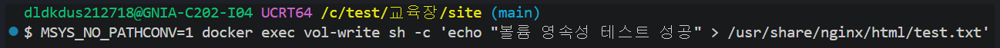


## 트러블슈팅

### 사례 1: 한글 깨짐
- 문제: 브라우저에서 한글 깨짐
- 원인: HTML 인코딩 미지정
- 해결: `<meta charset="UTF-8">` 추가

### 사례 2: 경로 변환 오류
- 문제: 바인드마운트 시 경로 오류
- 원인: Git Bash 자동 경로 변환
- 해결: `MSYS_NO_PATHCONV=1` 적용

### 사례 3: ! event not found
- 문제: echo에 느낌표 포함 시 오류
- 원인: Bash 특수문자(!) 해석
- 해결: 느낌표 제거

### 트러블슈팅 4. 8080 한글 깨짐
- 증상: 8082는 정상인데 8080만 한글 깨짐
- 원인: 8080은 charset 추가 전 빌드된 이미지 사용,
        8082는 바인드마운트로 수정본 반영
- 해결: docker build로 이미지 재빌드 후 컨테이너 재실행
- 교훈: 이미지는 빌드 시점 파일을 품으므로 수정 시 재빌드 필수

### 트러블슈팅 5: favicon.ico 404 로그

- 증상: docker logs 확인 시 /favicon.ico 요청에 404 발생
- 원인: 브라우저가 자동으로 사이트 아이콘(favicon)을 요청하나,
        이미지에 해당 파일이 없어 발생
- 해결: 정상 동작에 영향 없음을 확인. 필요 시 favicon.ico를
        추가하면 해소됨
- 교훈: 404가 항상 오류는 아니며, 로그를 통해 요청 흐름을 파악할 수 있음

## Dockerfile (커스텀 이미지)
```dockerfile
FROM nginx:alpine
COPY index.html /usr/share/nginx/html/index.html
```
- `FROM nginx:alpine`: 가벼운 alpine 버전 nginx 공식 이미지를 베이스로 사용
- `COPY index.html ...`: 내 index.html을 nginx 웹 폴더에 복사
- 빌드 명령: `docker build -t mysite .`
- 트러블슈팅 4번처럼, HTML 수정 시 반드시 재빌드해야 반영됨

## Docker 환경 정보
- docker --version 결과: 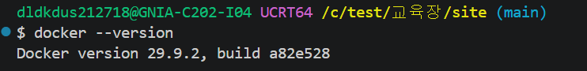
- docker images 결과: 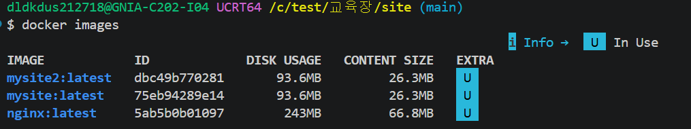
- docker ps -a 결과: 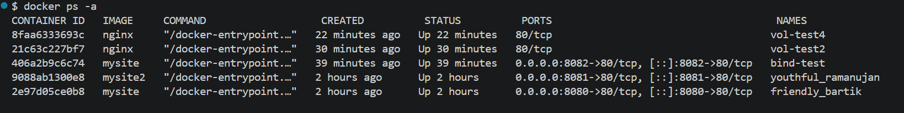
- docker stats 결과: 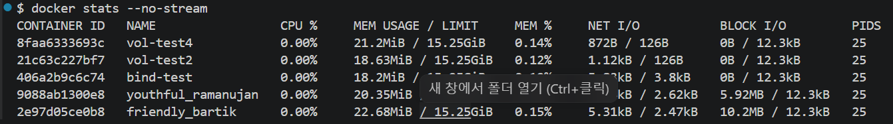

## 🔐 Linux 권한 실습
- chmod 644 testfile.txt (소유자 rw, 그룹/기타 r)
- chmod 755 testdir (소유자 rwx, 그룹/기타 rx)
- ls -l로 변경 전후 확인

## 터미널 기본 조작


### hello-world
hello-world 실행


**실행 로그 (텍스트):**

```bash
$ docker run hello-world

Hello from Docker!
This message shows that your installation appears to be working correctly.
...
```

### ubuntu
(위 4장 스크린샷)
- docker run -it ubuntu bash 로 컨테이너 진입 
- ls 로 내부 리눅스 구조 확인 
- echo 로 명령 실행 후 exit  

### attach vs exec 차이
- attach: 기존 메인 프로세스에 연결. exit 하면 컨테이너도 멈춤
- exec: 새 프로세스를 실행. exit 해도 컨테이너는 계속 실행됨

## 포트 접속 증거


### docker info 결과
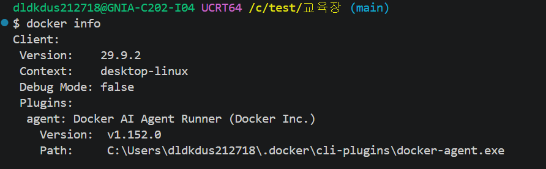
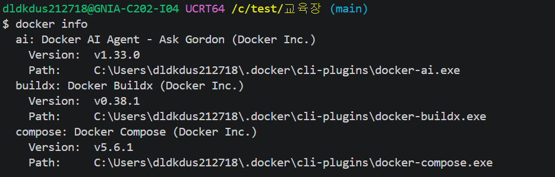
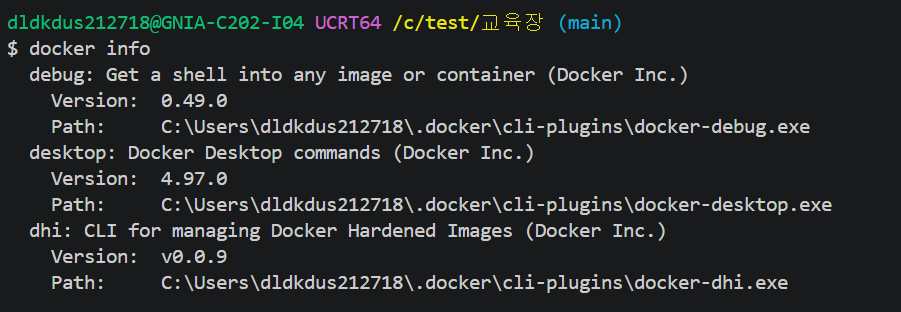
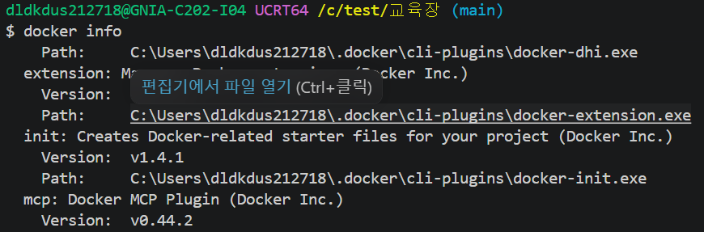
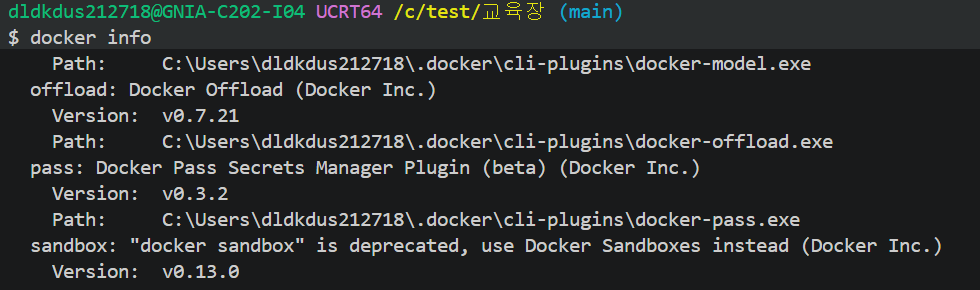
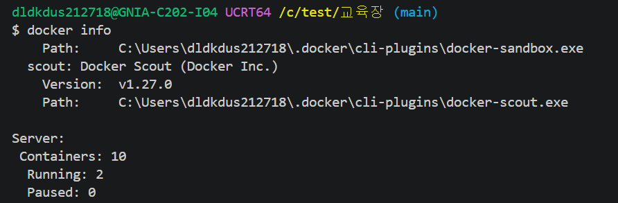
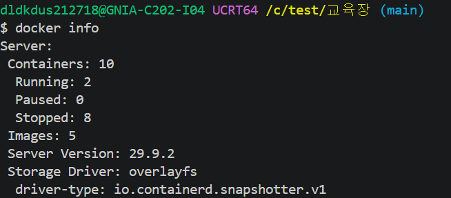
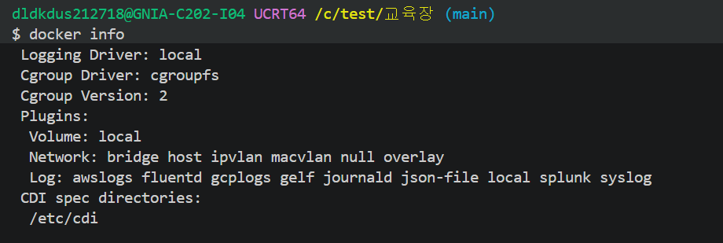
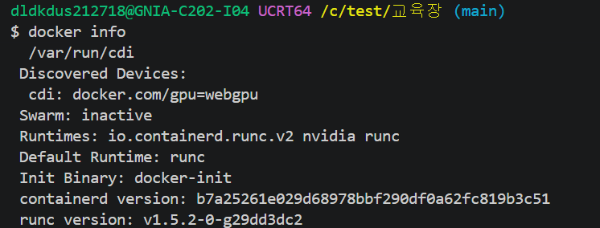
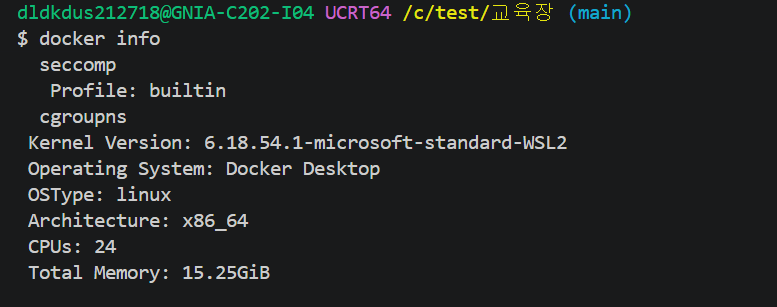
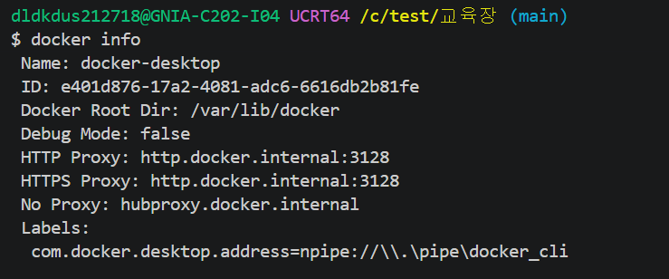
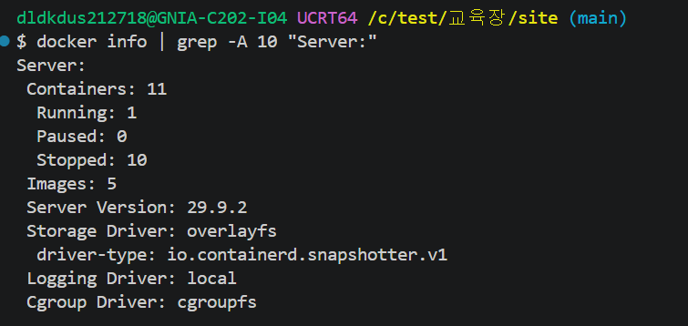 
-> Docker 데몬 정상 작동 확인

`docker info | grep -A 10 "Server:"` 명령으로
데몬(Server) 정보를 확인했다.

- **Server** 섹션이 에러 없이 출력됨 → 데몬 정상 연결
- **Running: 1** → 컨테이너 1개 작동 중
- **Server Version: 29.9.2** → 엔진 정상 구동


### docker logs 결과
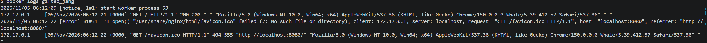

## #1 파일/폴더 생성·이동 기록

```
$ mkdir demo
$ touch demo/sample.txt
$ ls -l demo/
```
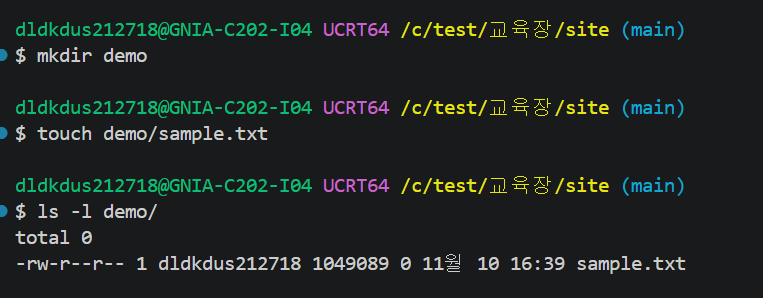

```
$ mv demo/sample.txt .
$ ls -l sample.txt
```
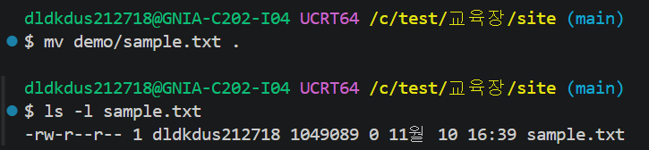


## #2 chmod 전후 비교

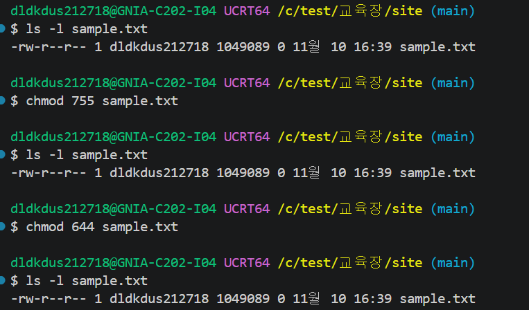

chmod 명령으로 파일 권한 변경을 실행함.
- chmod 755 : 소유자(rwx), 그룹(r-x), 기타(r-x)
- chmod 644 : 소유자(rw-), 그룹(r--), 기타(r--)

※ 참고: 본 실습은 Windows(Git Bash/UCRT64) 환경에서 진행되어
   NTFS 파일시스템 특성상 rwx 권한 변화가 화면에 반영되지 않음.
   리눅스 환경에서는 chmod 755 적용 시 -rwxr-xr-x 로 표시됨.

## Docker 빌드 결과

```
docker build -t mysite .

[+] Building 5.5s (7/7) FINISHED
 => [1/2] FROM nginx:alpine
 => [2/2] COPY index.html /usr/share/nginx/html/index.html
 => exporting to image
 => naming to docker.io/library/mysite:latest

→ 빌드 성공, mysite 이미지 생성 완료
```

## 생성된 이미지 확인
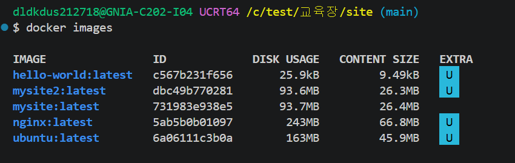

## Git 설정 확인

### git config --list

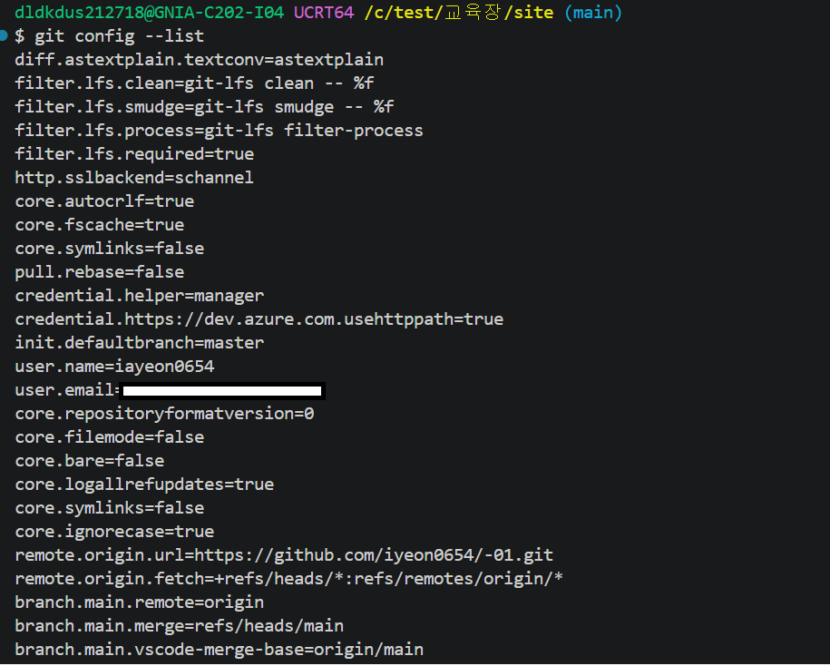


### git remote -v

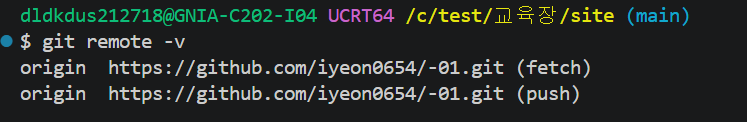
