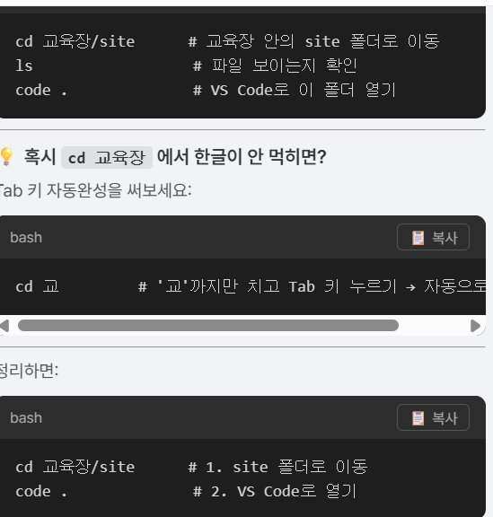

# 💻 컴퓨터 초기화 후 저장소 복구 방법

## 📌 상황
- 컴퓨터가 초기화되어 로컬 작업 파일이 모두 사라짐
- 다행히 GitHub 저장소에 코드가 올라가 있었음

## 🔧 복구 순서

### 1. Git 설치 확인
​```bash
git --version      # 버전 나오면 설치 OK
​```

### 2. 작업할 폴더로 이동
​```bash
cd /c/test         # 원하는 위치로 이동
​```

### 3. GitHub 저장소 클론
​```bash
git clone 저장소주소
​```

### 4. 폴더 확인 & 진입
​```bash
ls                 # 클론된 폴더 확인
cd 폴더이름/site    # 프로젝트 폴더로 이동
​```

### 5. VS Code로 열기
​```bash
code .
​```

